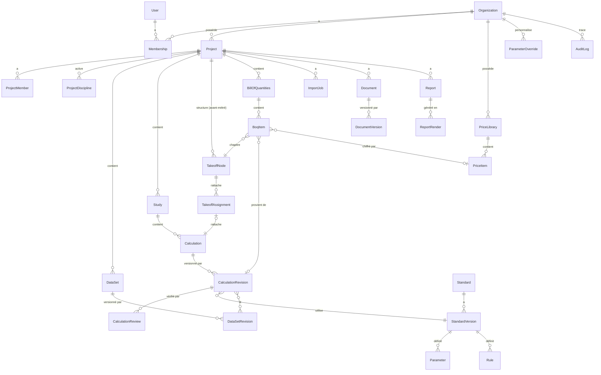

# 02 — Modèle de données

PostgreSQL 17+, accès via Prisma. Ce document est une **ébauche de conception**. Pour les
tables déjà livrées, la **source de vérité** est `packages/db/prisma/schema.prisma` et les
migrations SQL (RLS, droits, triggers) de `packages/db/prisma/migrations/`.

État : Phase 1 livrée (`users`, `sessions`, `accounts`, `verifications`, `rate_limits`,
`organizations`, `memberships`, `invitations`, `audit_logs`). Les autres entités arrivent
avec leur phase.

## 1. Règles transverses

| Règle                     | Détail                                                                                                                                                                         |
| ------------------------- | ------------------------------------------------------------------------------------------------------------------------------------------------------------------------------ |
| Identifiants              | UUID v7 (ordonnés dans le temps), générés par la base.                                                                                                                       |
| Multi-organisation        | **Toute** table métier porte `organization_id NOT NULL`, y compris quand elle est déductible d'un parent. Cela simplifie le filtrage et les politiques RLS ([ADR-0006](../adr/0006-isolation-multi-organisation.md)). |
| Portée projet             | Toute donnée rattachée à un projet porte aussi `project_id`.                                                                                                                   |
| Horodatage                | `created_at`, `updated_at` en `timestamptz` (UTC). L'affichage est converti dans le fuseau de l'utilisateur.                                                                  |
| Concurrence               | Les entités modifiables portent `version int` (verrouillage optimiste, renvoyé comme `ETag`).                                                                                 |
| Immuabilité               | `CalculationRevision`, `DataSetRevision`, `StandardVersion` publiée et ses paramètres, `ReportRender`, `AuditLog` : **aucun UPDATE ni DELETE**. Une garantie applicative est doublée d'un trigger PostgreSQL. |
| Suppression               | Projets et études sont **archivés**, jamais supprimés. Documents : suppression logique (`deleted_at`) puis purge planifiée et auditée.                                         |
| Montants                  | `Decimal(18,4)` + code devise ISO 4217 (`XOF`, `XAF`, `EUR`…). Jamais de flottant pour l'argent.                                                                              |
| Quantités physiques       | Les calculs se font en double précision (moteurs). Les quantités d'un quantitatif sont stockées en `Decimal(18,4)` avec l'unité, arrondies selon la précision déclarée de l'unité. |
| JSON                      | Toute colonne `jsonb` a un schéma Zod de référence et un `schema_version`. Aucun JSON « libre ».                                                                              |
| Nommage                   | Modèles Prisma en `PascalCase`, tables et colonnes en `snake_case` (`@@map` / `@map`).                                                                                        |

## 2. Vue d'ensemble



## 3. Entités par contexte

### 3.1 Identité et organisation

| Entité           | Rôle                                                                                                       | Champs clés                                                                                              |
| ---------------- | ---------------------------------------------------------------------------------------------------------- | -------------------------------------------------------------------------------------------------------- |
| `User`           | Personne authentifiée                                                                                      | email (unique), nom, locale, fuseau, `platform_role` (`NONE` \| `PLATFORM_ADMIN`)                        |
| `Session`, `Account`, `Verification` | Tables gérées par la bibliothèque d'authentification ([ADR-0009](../adr/0009-authentification.md)) | —                                                                                               |
| `Organization`   | Locataire (bureau d'études, entreprise)                                                                    | nom, slug, pays, devise par défaut, profil de référentiels par défaut                                    |
| `Membership`     | Appartenance d'un utilisateur à une organisation                                                           | `user_id`, `organization_id`, `role` (`OWNER` \| `ADMIN` \| `ENGINEER` \| `TECHNICIAN` \| `COLLABORATOR` \| `VIEWER`), statut |
| `Invitation`     | Invitation en attente                                                                                      | email, rôle proposé, jeton haché, expiration                                                             |

### 3.2 Projets

| Entité              | Rôle                                         | Champs clés                                                                                                   |
| ------------------- | -------------------------------------------- | ------------------------------------------------------------------------------------------------------------- |
| `Project`           | Objet central                                | code, nom, description, maître d'ouvrage, localisation, statut (`ACTIVE` \| `ARCHIVED`), dates, `version`     |
| `ProjectMember`     | Accès d'un membre à un projet                | `user_id`, rôle projet (restreint, jamais supérieur au rôle d'organisation)                                   |
| `ProjectDiscipline` | Métier activé et ses référentiels            | discipline (`BTP` \| `ELEC` \| `PLUMBING` \| `TOPO`), profil de référentiels choisi                           |
| `ActivityEvent`     | Fil d'activité visible des membres           | acteur, type, cible, résumé (distinct du journal d'audit, qui est sécuritaire)                                |

### 3.3 Données de projet

Les données d'entrée réutilisables (points topographiques, observations, liste
d'appareils sanitaires, tableaux et départs électriques, pièces d'un bâtiment…) sont
des **jeux de données** typés et versionnés.

| Entité            | Rôle                                                    | Champs clés                                                                                        |
| ----------------- | ------------------------------------------------------- | -------------------------------------------------------------------------------------------------- |
| `DataSet`         | Jeu de données nommé                                    | discipline, `kind` (ex. `TOPO_POINTS`, `TOPO_OBSERVATIONS`, `ELEC_BOARD_TREE`, `SANITARY_FIXTURES`, `PLUMBING_NETWORK`), révision courante |
| `DataSetRevision` | Contenu immuable d'une version                          | numéro, `rows jsonb` (validé par le schéma du `kind`), `schema_version`, système de coordonnées et unités (si pertinent), origine (`MANUAL` \| `IMPORT`), `import_job_id`, auteur |

Choix : stockage des lignes en `jsonb` validé par Zod plutôt qu'une table par type.
Les volumes attendus (quelques milliers de points par levé) le permettent. On
réévaluera si un jeu dépasse ~50 000 lignes (mesure prévue en Phase 7).

### 3.4 Études et calculs

| Entité                   | Rôle                                                       | Champs clés                                                                                                                                                                                                                                                                              |
| ------------------------ | ---------------------------------------------------------- | ---------------------------------------------------------------------------------------------------------------------------------------------------------------------------------------------------------------------------------------------------------------------------------------- |
| `Study`                  | Regroupement de calculs d'un métier (ex. « Bilan de puissance — Bâtiment A ») | discipline, titre, description, statut, `version`                                                                                                                                                                                                       |
| `Calculation`            | Calcul logique, identifié par un moteur                    | `engine_id` (ex. `elec.voltage-drop`), titre, `current_revision_id`                                                                                                                                                                                                                      |
| `CalculationRevision`    | **Instantané immuable** d'une exécution                    | numéro de révision ; `engine_id`, `engine_version` ; `standard_version_id` ; `parameter_snapshot jsonb` + `parameter_snapshot_hash` ; `inputs jsonb` ; `outputs jsonb` ; `checks jsonb` ; `warnings jsonb` ; `hypotheses jsonb` ; `trace jsonb` ; `result_status` ; `workflow_status` ; `author_id` ; `created_at` |
| `CalculationReview`      | Validation et vérification                                 | `revision_id`, type (`VALIDATION` \| `VERIFICATION`), décision (`APPROVED` \| `REJECTED`), commentaire, auteur, date                                                                                                                                                                       |
| `CalculationDependency`  | Une révision consomme le résultat d'une autre              | `source_revision_id`, `target_revision_id`. Si la source reçoit une nouvelle révision, la cible est signalée **obsolète**.                                                                                                                                                                  |
| `CalculationDatasetLink` | Une révision lit un jeu de données du projet (Phase 5)     | `revision_id`, `input`, `dataset_id`, `dataset_revision_id` (révision lue). Ajout seul ; même projet contrôlé par la base. Si le jeu reçoit une nouvelle révision, le calcul est signalé **obsolète**.                                                                                       |

Cycle de vie d'une révision (`workflow_status`) :

```
COMPUTED ──(auteur valide)──▶ VALIDATED ──(vérificateur ≠ auteur)──▶ VERIFIED
    │                              │
    └────────── nouvelle révision ◀┴── REJECTED (motif obligatoire)
```

Mise en œuvre (Phase 3) : la révision stocke les références de toutes les versions de
référentiels utilisées (`standards`), la saisie d'origine (`raw_inputs`, entrées liées comprises),
les entrées normalisées, les erreurs et la présentation du moteur (libellés, précisions) au moment
du calcul. Une exécution `INVALID` n'est pas enregistrée. Tables du lot D : `notifications`
(visibles de leur seul destinataire) et `two_factors` (plugin TOTP de Better Auth).

`result_status` est fixé par le moteur : `OK`, `OK_WITH_WARNINGS`, `NON_COMPLIANT`,
`INVALID` (entrées refusées) ou `ERROR` (défaut interne, jamais présenté comme un résultat).

### 3.5 Avant-métré, quantitatifs et prix (Phase 4)

| Entité              | Rôle                                         | Champs clés                                                                                                                       |
| ------------------- | -------------------------------------------- | --------------------------------------------------------------------------------------------------------------------------------- |
| `TakeoffNode`       | Nœud de l'avant-métré : lot, niveau, ouvrage | `kind` (`LOT` à la racine, `LEVEL` dans un lot, `ELEMENT` dans un lot ou un niveau), code unique parmi les frères, intitulé, parent (même projet) |
| `TakeoffAssignment` | Rattachement d'un calcul BTP à un nœud       | `calculation_id` (clé : un nœud au plus par calcul), `node_id`, auteur du rattachement                                         |
| `BillOfQuantities`  | Quantitatif / DQE d'un projet                | titre, devise (ISO 4217), présentation (`DETAILED` \| `AGGREGATED`, ADR-0011), `synced_at`, `version` ; sa structure est celle de l'avant-métré (pas de table de sections distincte) |
| `BoqItem`           | Ligne de quantitatif                         | nœud, origine (`CALCULATION` | `MANUAL`), calcul + sortie + entrée ventilée (`output_part`, ex. un diamètre de tube, et désignation de son groupe) + `source_revision_id` (traçabilité), ouvrage (`work_key`), désignation, unité, quantité `NUMERIC(18,4)`, quantité retenue + justification, prix unitaire facultatif, article de prix d'origine |
| `PriceLibrary`      | Bibliothèque de prix d'une organisation      | nom (unique), devise, date de validité                                                                                            |
| `PriceItem`         | Prix unitaire                                | code, désignation, unité, prix `NUMERIC(18,4)`, ouvrage facultatif (un prix par ouvrage et par bibliothèque)                     |

Une quantité issue d'un calcul reste liée à sa révision et ne se modifie qu'en recalculant ;
une quantité retenue différente exige une justification, reste affichée à côté de la quantité
calculée et est journalisée (principe P4). La base contrôle l'origine des lignes, la
justification, les montants positifs, l'appartenance du calcul au projet et de l'article de prix
à l'organisation ; l'avant-métré et les quantitatifs d'un projet archivé sont en lecture seule.

### 3.6 Bibliothèque technique et référentiels

Détails : [11 — Référentiels](11-referentiels.md).

| Entité                | Rôle                                                                 | Champs clés                                                                                                                                         |
| --------------------- | -------------------------------------------------------------------- | --------------------------------------------------------------------------------------------------------------------------------------------------- |
| `Standard`            | Référentiel (norme, guide, usage)                                    | code (ex. `NFC15-100`), titre, éditeur, discipline, nature (`NORM` \| `GUIDE` \| `PRACTICE` \| `CUSTOM`), portée (`SYSTEM` \| organisation)          |
| `StandardVersion`     | Version datée, **immuable une fois publiée**                         | libellé de version, statut (`DRAFT` \| `PUBLISHED` \| `DEPRECATED`), date de publication, notes de source                                            |
| `Parameter`           | Valeur, coefficient ou table                                          | clé stable (ex. `elec.voltage_drop.limit.lighting.public_lv`), type (`SCALAR` \| `TABLE` \| `ENUM`), `value jsonb`, unité, source (document, article, tableau), `verification` (`VERIFIED` \| `TO_VERIFY`) |
| `Rule`                | Règle de vérification                                                 | code, description, sévérité, référence d'article, clés de paramètres utilisées, identifiant de l'implémentation dans le moteur                     |
| `StandardProfile`     | Ensemble de référentiels par défaut                                   | nom (ex. « Afrique francophone — usage courant »), versions retenues par discipline                                                               |
| `ParameterOverride`   | Paramètre personnalisé                                                | portée (organisation ou projet), version de référentiel, clé, valeur, **justification obligatoire**, auteur                                       |
| `Catalog`, `CatalogItem` | Matériaux, sections de câbles, diamètres de tubes, équipements, aciers | type de catalogue, propriétés `jsonb` validées par type, unités, source                                                                         |

Les **formules** et les **unités** ne sont pas en base : elles sont générées depuis les
métadonnées des moteurs et le registre d'unités de `calc-core`. Elles ne peuvent donc
jamais diverger du code qui calcule.

### 3.7 Imports

| Entité                  | Rôle                                   | Champs clés                                                                                                                                                                                |
| ----------------------- | -------------------------------------- | ------------------------------------------------------------------------------------------------------------------------------------------------------------------------------------------ |
| `ImportJob`             | Un import et son état                  | source (`XLSX` \| `CSV` \| `PASTE_EXCEL` \| `PASTE_WORD`), cible (`kind` de jeu de données), statut (`UPLOADED` → `DETECTED` → `MAPPED` → `VALIDATED` → `PREVIEWED` → `IMPORTED`, ou `FAILED` / `CANCELLED`), `detection jsonb`, `mapping jsonb`, rapport de validation, compteurs |
| `ImportStagingRow`      | Lignes en transit (aperçu paginé)      | index, brut, normalisé, erreurs. Purgées après import ou expiration.                                                                                                                      |
| `ImportMappingTemplate` | Mapping réutilisable                   | cible, nom, correspondances colonnes → champs, transformations                                                                                                                            |

### 3.8 Documents et fichiers

| Entité            | Rôle                          | Champs clés                                                                                                     |
| ----------------- | ----------------------------- | --------------------------------------------------------------------------------------------------------------- |
| `FileObject`      | Fichier stocké                | clé de stockage, nom d'origine assaini, type MIME **détecté**, taille, SHA-256, statut d'analyse (`PENDING` \| `CLEAN` \| `REJECTED`) |
| `Document`        | Document de projet            | titre, catégorie, révision courante, `deleted_at`                                                              |
| `DocumentVersion` | Version d'un document         | numéro, `file_object_id`, auteur, commentaire                                                                   |

### 3.9 Rapports

| Entité           | Rôle                          | Champs clés                                                                                                                                                      |
| ---------------- | ----------------------------- | ---------------------------------------------------------------------------------------------------------------------------------------------------------------- |
| `ReportTemplate` | Modèle (organisation)         | sections, en-tête, logo (`FileObject`), mentions                                                                                                                |
| `Report`         | Rapport de projet             | titre, objet, auteur, sections éditables (objet, observations, conclusion), révisions de calcul sélectionnées                                                  |
| `ReportRender`   | Génération **immuable**       | format (`PDF` \| `DOCX` \| `XLSX`), `file_object_id`, instantané du contenu (`jsonb`), révisions sources figées, générateur, date                                |

### 3.10 Sécurité et exploitation

| Entité         | Rôle                                                                                                                                   |
| -------------- | -------------------------------------------------------------------------------------------------------------------------------------- |
| `AuditLog`     | Journal append-only : acteur, organisation, action, cible, différences avant/après (champs sensibles exclus), IP, user-agent, identifiant de requête, date |
| `Notification` | Notifications in-app (destinataire, type, lien, lu/non lu)                                                                             |
| `RateLimit`    | Compteurs du limiteur de débit (si stockage PostgreSQL retenu)                                                                         |
| `pgboss.*`     | Schéma géré par pg-boss pour les jobs                                                                                                  |

## 4. Ébauche Prisma (cœur)

Extrait indicatif. Il sera affiné et testé en Phase 1 et en Phase 3.

```prisma
enum OrgRole { OWNER ADMIN ENGINEER TECHNICIAN COLLABORATOR VIEWER }
enum Discipline { BTP ELEC PLUMBING TOPO }
enum ProjectStatus { ACTIVE ARCHIVED }
enum ResultStatus { OK OK_WITH_WARNINGS NON_COMPLIANT INVALID ERROR }
enum WorkflowStatus { COMPUTED VALIDATED VERIFIED REJECTED }
enum StandardVersionStatus { DRAFT PUBLISHED DEPRECATED }
enum VerificationStatus { VERIFIED TO_VERIFY }

model Organization {
  id         String   @id @default(uuid(7)) @db.Uuid
  name       String
  slug       String   @unique
  country    String?  @db.Char(2)
  currency   String   @default("XOF") @db.Char(3)
  createdAt  DateTime @default(now()) @map("created_at") @db.Timestamptz
  updatedAt  DateTime @updatedAt @map("updated_at") @db.Timestamptz
  memberships Membership[]
  projects    Project[]
  @@map("organizations")
}

model Membership {
  id             String  @id @default(uuid(7)) @db.Uuid
  organizationId String  @map("organization_id") @db.Uuid
  userId         String  @map("user_id") @db.Uuid
  role           OrgRole
  organization   Organization @relation(fields: [organizationId], references: [id])
  @@unique([organizationId, userId])
  @@map("memberships")
}

model Project {
  id             String        @id @default(uuid(7)) @db.Uuid
  organizationId String        @map("organization_id") @db.Uuid
  code           String
  name           String
  status         ProjectStatus @default(ACTIVE)
  version        Int           @default(1)
  createdById    String        @map("created_by_id") @db.Uuid
  createdAt      DateTime      @default(now()) @map("created_at") @db.Timestamptz
  updatedAt      DateTime      @updatedAt @map("updated_at") @db.Timestamptz
  organization   Organization  @relation(fields: [organizationId], references: [id])
  @@unique([organizationId, code])
  @@index([organizationId, status])
  @@map("projects")
}

model Calculation {
  id                String  @id @default(uuid(7)) @db.Uuid
  organizationId    String  @map("organization_id") @db.Uuid
  projectId         String  @map("project_id") @db.Uuid
  studyId           String  @map("study_id") @db.Uuid
  engineId          String  @map("engine_id")
  title             String
  currentRevisionId String? @unique @map("current_revision_id") @db.Uuid
  revisions         CalculationRevision[]
  @@index([organizationId, projectId])
  @@map("calculations")
}

model CalculationRevision {
  id                    String         @id @default(uuid(7)) @db.Uuid
  organizationId        String         @map("organization_id") @db.Uuid
  projectId             String         @map("project_id") @db.Uuid
  calculationId         String         @map("calculation_id") @db.Uuid
  number                Int
  engineId              String         @map("engine_id")
  engineVersion         String         @map("engine_version")
  standardVersionId     String?        @map("standard_version_id") @db.Uuid
  parameterSnapshot     Json           @map("parameter_snapshot")
  parameterSnapshotHash String         @map("parameter_snapshot_hash")
  inputs                Json
  outputs               Json?
  checks                Json
  warnings              Json
  hypotheses            Json
  trace                 Json
  resultStatus          ResultStatus   @map("result_status")
  workflowStatus        WorkflowStatus @default(COMPUTED) @map("workflow_status")
  authorId              String         @map("author_id") @db.Uuid
  createdAt             DateTime       @default(now()) @map("created_at") @db.Timestamptz
  calculation           Calculation    @relation(fields: [calculationId], references: [id])
  @@unique([calculationId, number])
  @@map("calculation_revisions")
}
```

Note : `workflow_status` évolue (COMPUTED → VALIDATED → VERIFIED). Pour garder la
révision immuable, ce statut est **dérivé** des lignes `CalculationReview` (append-only)
et seulement dénormalisé dans `calculation_revisions` par un trigger contrôlé. C'est la
seule colonne de la table autorisée à changer.
