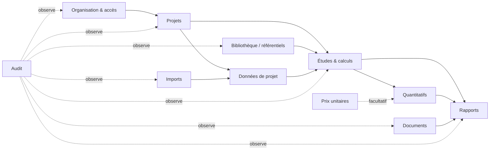

# 03 — Modules

## 1. Typologie

Chaque élément de navigation est l'un de ces types :

| Type             | Description                                                                                         | Exemple                         |
| ---------------- | --------------------------------------------------------------------------------------------------- | ------------------------------- |
| **Tableau de bord** | Agrégats en lecture sur des données réelles du projet (études, statuts, avertissements, activité) | Dashboard Électricité           |
| **Données**      | Saisie ou import d'un jeu de données typé et versionné                                              | Points, Appareils sanitaires    |
| **Calcul**       | Exécution d'un moteur (`calc-*`) → révision versionnée                                              | Chute de tension                |
| **Quantitatif**  | Agrégation de quantités issues de calculs, avec prix facultatifs                                     | Quantitatifs BTP                |

Le **registre de modules** (`domain`) décrit chaque module : identifiant, discipline,
type, moteur associé, phase de livraison. L'interface, la navigation et la recherche
Ctrl+K sont générées depuis ce registre.

## 2. Modules transverses

| Module                | Contenu                                                                                                                         | Phase |
| --------------------- | ------------------------------------------------------------------------------------------------------------------------------- | ----- |
| Identité et organisation | Inscription, connexion, invitations, membres, rôles, paramètres d'organisation                                             | 1     |
| Audit                 | Journal append-only, consultation filtrée (Owner, Admin)                                                                        | 1     |
| Shell et design system | Sidebar + header + espace de travail, mobile, thème sombre, Ctrl+K, raccourcis, états loading / empty / error, confirmations, notifications | 2 |
| Projets               | Création, modification, archivage, membres, permissions, activité, métiers activés                                              | 3     |
| Données de projet     | Jeux de données typés, révisions, saisie tabulaire                                                                              | 3     |
| Études et calculs     | Exécution des moteurs, historique des révisions, comparaison de révisions, validation / vérification, dépendances et obsolescence | 3     |
| Bibliothèque technique | Référentiels, normes, tables, coefficients, formules (générées), unités, matériaux, sections, équipements, paramètres personnalisés | 3 (socle), puis enrichie à chaque métier |
| Quantitatifs et prix  | Quantitatifs, lots, bibliothèque de prix unitaires facultatifs                                                                  | 4     |
| Imports               | Upload → détection → mapping → validation → aperçu → import                                                                     | 7 (cœur), 8 (généralisé) |
| Documents             | Upload sécurisé, versions, catégories                                                                                            | 8     |
| Rapports              | Report Builder, rendus PDF / DOCX / XLSX                                                                                         | 9     |
| Recherche globale     | Ctrl+K : navigation, projets, études, calculs, documents. Recherche plein texte PostgreSQL (`pg_trgm` + `tsvector` en français) | 2 (navigation), 3 (données) |
| Notifications         | In-app : invitation, demande de vérification, calcul rejeté, rapport généré, import terminé                                     | 3     |

## 3. Modules métier

Les identifiants de moteurs sont stables et versionnés (`<discipline>.<calcul>`). Les
**paramètres** cités viennent toujours des référentiels ([11](11-referentiels.md)).
Les valeurs mentionnées ici sont des exemples de nature, pas des valeurs retenues.

### 3.1 BTP / Génie civil — Phase 4

Objet : **calcul des quantités** (interprétation I2). Prix unitaires facultatifs.

| Module          | Type        | Moteur                    | Calcule                                                                                                      | Paramètres issus des référentiels                                    |
| --------------- | ----------- | ------------------------- | ------------------------------------------------------------------------------------------------------------ | ------------------------------------------------------------------- |
| Dashboard       | Tableau de bord | —                     | Avancement des métrés, totaux par lot, alertes                                                               | —                                                                   |
| Avant-métré     | Données     | —                         | Structure des ouvrages par lot / niveau / élément, rattachement des calculs                                   | —                                                                   |
| Terrassement    | Calcul      | `btp.earthworks`          | Fouilles en pleine masse, en rigole, en puits ; remblais ; volume foisonné à évacuer                          | Coefficients de foisonnement et de tassement par type de sol        |
| Fondations      | Agrégat     | —                         | Sous-total du lot « Fondations » de l'avant-métré (semelles + longrines + béton de propreté) ; pas de moteur, pour ne rien compter deux fois | —      |
| Semelles        | Calcul      | `btp.footings`            | Isolées et filantes : béton de propreté, béton, coffrage, aciers (ratio ou nomenclature)                      | Épaisseur de propreté, ratios d'acier, dosages                      |
| Longrines       | Calcul      | `btp.ground-beams`        | Béton, coffrage, aciers                                                                                       | Ratios d'acier, dosages                                             |
| Poteaux         | Calcul      | `btp.columns`             | Béton, coffrage, aciers                                                                                       | Ratios d'acier, dosages                                             |
| Poutres         | Calcul      | `btp.beams`               | Béton, coffrage (fond + joues), aciers                                                                        | Ratios d'acier, dosages                                             |
| Dalles          | Calcul      | `btp.slabs`               | Dalle pleine ; plancher à corps creux (hourdis + table de compression, ex. 16+4) ; nombre d'entrevous         | Dimensions des entrevous, ratios, dosages                           |
| Escaliers       | Calcul      | `btp.stairs`              | Paillasse, marches, palier : béton, coffrage, aciers ; contrôle de confort (formule de Blondel)               | Plage de Blondel (vérification)                                     |
| Maçonnerie      | Calcul      | `btp.masonry`             | Surfaces nettes (déduction des ouvertures), volume de mortier                                                 | Règles de déduction des ouvertures, dosages de mortier              |
| Blocs           | Calcul      | `btp.blocks`              | Nombre d'agglos (10 / 15 / 20) par m², joints, pertes                                                         | Dimensions des blocs, épaisseur de joint, taux de perte             |
| Cloisons        | Calcul      | `btp.partitions`          | Surfaces, blocs ou plaques, accessoires                                                                       | Taux de perte                                                       |
| Enduits         | Calcul      | `btp.renders`             | Surfaces (intérieur / extérieur), épaisseurs, mortier, ciment, sable                                          | Dosages, épaisseurs usuelles                                        |
| Carrelage       | Calcul      | `btp.tiling`              | Surfaces, carreaux (pertes de coupe), mortier-colle ou mortier de pose, joints, plinthes                      | Taux de perte, consommations                                        |
| Peinture        | Calcul      | `btp.painting`            | Surfaces, nombre de couches, litres (rendement), impression                                                    | Rendements (m²/L)                                                   |
| Quantitatifs    | Quantitatif | —                         | DQE / bordereau par lot ; décomposition en matériaux (ciment en sacs de 50 kg, sable, gravier, eau, aciers)    | Dosages, masses volumiques                                          |

### 3.2 Électricité — Phase 5

Chaque calcul affiche : données d'entrée, hypothèses, paramètres, résultat, vérification,
avertissements (structure commune `CalculationResult`, voir [10](10-moteur-de-calcul.md)).

| Module               | Type        | Moteur                    | Calcule                                                                                                                                  |
| -------------------- | ----------- | ------------------------- | ---------------------------------------------------------------------------------------------------------------------------------------- |
| Dashboard            | Tableau de bord | —                     | Puissance totale, départs non conformes, calculs non vérifiés                                                                            |
| Tableaux / Départs / Équipements | Données | —             | Arborescence TGBT → tableaux divisionnaires → départs → récepteurs (`ELEC_BOARD_TREE`)                                                   |
| Bilan de puissance   | Calcul      | `elec.power-balance`      | Puissance installée, coefficients d'utilisation (ku) et de simultanéité (ks), puissances active / réactive / apparente, cos φ global, par tableau |
| Courant d'emploi    | Calcul      | `elec.design-current`     | Mono : I_B = P / (V·cos φ) ; tri : I_B = P / (√3·U·cos φ)                                                                                   |
| Circuits monophasés / triphasés | Calcul | `elec.circuit`     | Chaîne complète d'un circuit : I_B → protection I_n → section (I_z) → chute de tension                                                   |
| Câbles / Sections    | Calcul      | `elec.cable-sizing`       | Section minimale selon I_z corrigé (mode de pose, température ambiante, groupement, nature de l'âme et de l'isolant)                      |
| Chute de tension     | Calcul      | `elec.voltage-drop`       | ΔU = b·(ρ₁·L/S·cos φ + λ·L·sin φ)·I_B ; ΔU % ; comparaison aux limites                                                                   |
| Disjoncteurs / Protections | Calcul | `elec.protection`      | Condition I_B ≤ I_n ≤ I_z ; courbe (B / C / D) ; différentiel ; contrôle du pouvoir de coupure lorsque I_cc est fourni                     |

Point d'attention Afrique francophone : les températures ambiantes (souvent 35 à 40 °C
et plus) rendent les **facteurs de correction de température** décisifs. La
température ambiante est donc une **entrée obligatoire** et jamais un défaut silencieux.

Le calcul des courants de court-circuit (I_cc) n'est pas listé dans le cahier des
charges : il est accepté **en entrée** (valeur fournie par le distributeur ou par une
étude) et non calculé. On pourra l'ajouter plus tard.

Mise en œuvre (Phase 5) : le bilan de puissance lit l'arbre `ELEC_BOARD_TREE` du projet
(révision courante, tracée). Les courants admissibles couvrent l'âme cuivre et les méthodes de
référence B, C et E ; la protection vérifie I_B ≤ I_n et I2 = k2 · I_n ≤ 1,45 I_z, sans courbes
de déclenchement B / C / D (voir [07](07-roadmap.md), écarts de la Phase 5).

### 3.3 Plomberie & Sanitaire — Phase 6

| Module                | Type        | Moteur                        | Calcule                                                                                                                    |
| --------------------- | ----------- | ----------------------------- | -------------------------------------------------------------------------------------------------------------------------- |
| Dashboard             | Tableau de bord | —                         | Débits de pointe, réseaux non conformes, calculs non vérifiés                                                              |
| Appareils sanitaires  | Données     | —                             | Inventaire par local / niveau (`SANITARY_FIXTURES`)                                                                         |
| Débits                | Calcul      | `plumbing.flow-rates`         | Débits de base par appareil, coefficient de simultanéité, débit probable par tronçon                                        |
| Eau froide / Eau chaude / Distribution | Calcul | `plumbing.supply-network` | Réseau arborescent : débits, diamètres, vitesses, pertes de charge, pression disponible aux points de puisage           |
| Diamètres             | Calcul      | `plumbing.pipe-sizing`        | Diamètre minimal selon débit et vitesse admissible                                                                          |
| Pertes de charge      | Calcul      | `plumbing.head-loss`          | Linéaires (Darcy-Weisbach / Colebrook-White, itératif, convergence tracée) et singulières                                    |
| Pressions             | Calcul      | `plumbing.pressure-check`     | Pression disponible = pression amont − dénivelé − pertes ; comparaison au minimum requis par appareil                        |
| Eaux usées / Eaux vannes / Évacuation | Calcul | `plumbing.drainage`       | Débits d'évacuation, diamètres des branchements, chutes et collecteurs, pentes                                               |
| Assainissement / Fosses | Calcul    | `plumbing.septic-tank`        | Volume de fosse selon la population desservie ou le nombre de pièces, temps de séjour                                       |
| Regards               | Calcul      | `plumbing.manholes`           | Implantation selon les changements de direction, de pente et l'espacement maximal ; profondeurs                              |
| Réservoirs            | Calcul      | `plumbing.storage-tank`       | Volume = consommation journalière × autonomie (+ réserve) ; dimensions                                                       |
| Pompes                | Calcul      | `plumbing.pump`               | HMT = hauteur géométrique + pertes + pression résiduelle ; puissance hydraulique ρ·g·Q·H et absorbée (rendement)              |
| Chauffe-eau           | Calcul      | `plumbing.water-heater`       | Volume ECS selon les besoins ; énergie Q = m·c·ΔT ; puissance pour un temps de chauffe donné                                 |
| Quantitatifs          | Quantitatif | —                             | Linéaires de tubes par diamètre, appareils, regards, accessoires                                                             |

Point d'attention : la distribution par **réservoir surélevé + surpresseur** et les
**fosses septiques avec puisard** sont courantes. Les moteurs les traitent comme des
cas de première classe, pas comme des exceptions.

### 3.4 Topographie — Phase 7

Conventions métier francophones retenues par défaut (paramétrables) : angles en
**grades (gon)**, gisement compté depuis le **Nord (axe Y)** dans le sens horaire,
X = Est, Y = Nord, Z = altitude.

| Module        | Type        | Moteur                     | Calcule                                                                                                                                                         |
| ------------- | ----------- | -------------------------- | --------------------------------------------------------------------------------------------------------------------------------------------------------------- |
| Dashboard     | Tableau de bord | —                      | Jeux de points, cheminements, fermetures hors tolérance                                                                                                         |
| Points / Coordonnées | Données | —                    | Jeux de points (matricule, X, Y, Z, code, description), système de coordonnées déclaré                                                                          |
| Coordonnées   | Calcul      | `topo.coordinates`         | Conversions d'unités angulaires (gon, degrés, DMS, radians) ; gisement et distance entre deux points ; rayonnement (point lancé)                                  |
| Levé          | Calcul      | `topo.radiation-survey`    | Calcul de points levés par rayonnement depuis une station orientée ; réduction des distances inclinées à l'horizontale                                          |
| Polygonal     | Calcul      | `topo.traverse`            | Cheminement fermé, encadré ou ouvert : fermeture angulaire, compensation angulaire, gisements, ΔX / ΔY, fermeture planimétrique (f_X, f_Y, f_L), précision relative |
| Fermeture     | Vérification | (inclus dans `topo.traverse` et `topo.leveling`) | Comparaison des fermetures aux tolérances                                                                                         |
| Compensation / Bowditch | Calcul | `topo.traverse` (méthode `BOWDITCH`) | Répartition de f_X et f_Y proportionnellement aux longueurs. D'autres méthodes (Transit) pourront être ajoutées comme options explicites.               |
| Nivellement   | Calcul      | `topo.leveling`            | Nivellement direct (lectures arrière / avant), dénivelées, fermeture, compensation (proportionnelle aux distances ou au nombre de stations), altitudes compensées |
| Implantation  | Calcul      | `topo.stakeout`            | Fiche d'implantation : angle horizontal et distance depuis une station orientée vers chaque point à implanter                                                   |
| Contrôles     | Calcul      | `topo.control`             | Écarts entre coordonnées théoriques et levées (ΔX, ΔY, ΔZ, écart planimétrique) ; comparaison aux tolérances                                                   |

Imports (XLSX, CSV, copier-coller Excel, copier-coller Word) avec mapping et validation :
voir [13](13-imports-et-rapports.md). Les tolérances de fermeture n'ont pas de source
normative universelle. Elles sont des **paramètres explicites** du projet ou de
l'organisation, avec des valeurs par défaut marquées `TO_VERIFY`.

## 4. Dépendances fonctionnelles entre modules

