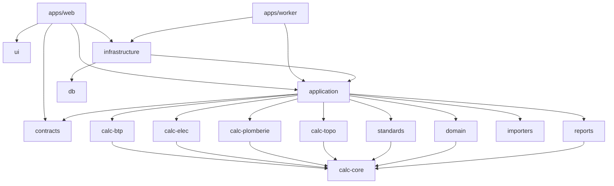

# 04 — Dépendances

## 1. Graphe des packages internes

`apps/web` et `apps/worker` sont les seules **racines de composition** : c'est là que les
implémentations d'infrastructure sont branchées sur les ports de l'application.

## 2. Règles d'import (vérifiées en CI par `dependency-cruiser`)

| Package              | Peut importer                                                               | Ne doit **jamais** importer                                       |
| -------------------- | --------------------------------------------------------------------------- | ----------------------------------------------------------------- |
| `calc-core`          | `zod`                                                                       | tout autre package interne, Node.js (`fs`, `process`), réseau      |
| `calc-*`             | `calc-core`, `zod`                                                          | `domain`, `application`, `db`, `infrastructure`, autre `calc-*`    |
| `standards`          | `calc-core`, `zod`                                                          | `db`, `infrastructure`, `application`                              |
| `domain`             | `calc-core` (types), `zod`                                                  | `application`, `db`, `infrastructure`, React, Next.js              |
| `contracts`          | `zod`                                                                       | tout package interne sauf types purs                               |
| `importers`          | `zod`, ExcelJS, Papa Parse, `chardet`, `iconv-lite`                         | `domain`, `db`, `infrastructure` : le schéma cible lui est **injecté** par l'application |
| `reports`            | `calc-core` (types de résultat), `docx`, ExcelJS, moteur PDF                 | `db`, `infrastructure` : il reçoit un modèle de document déjà assemblé |
| `application`        | `domain`, `contracts`, `standards`, `calc-*`, `importers`, `reports`        | `db`, `infrastructure`, Prisma, Next.js, React                     |
| `infrastructure`     | `application` (ports), `db`, SDK externes                                   | `apps/*`, React                                                    |
| `ui`                 | React, Radix, Tailwind, `lucide-react`, `motion`, `contracts` (types d'API) | `application`, `domain`, `calc-*`, `db`, Next.js (règle `design-system-isolated`) |
| `apps/web` (composants) | `ui`, `contracts`, hooks de l'app                                        | `calc-*` (sauf module d'aperçu dédié), `db`, Prisma                |

Règles complémentaires :

- **Pas de dépendance circulaire** (contrôle `no-circular`).
- **Moteurs purs** : une règle ESLint dans `calc-*` et `calc-core` interdit `Date`,
  `Math.random`, `fetch`, `process`, `console` et `setTimeout`.
- **Aperçu côté client** : un seul fichier de `apps/web` (`features/calculations/preview.ts`)
  peut importer un moteur pour l'aperçu instantané. Le résultat qui fait foi reste
  calculé côté serveur (principe P5).

## 3. Bibliothèques externes

Les versions exactes sont figées en Phase 1 (dernières versions stables à cette date)
et tenues à jour par Renovate.

### 3.1 Imposées par le cahier des charges

| Domaine         | Bibliothèque                                | Rôle                                                                     |
| --------------- | ------------------------------------------- | ------------------------------------------------------------------------ |
| Framework       | Next.js (App Router), React, TypeScript     | UI et adaptateurs HTTP                                                   |
| Style           | Tailwind CSS, shadcn/ui (Radix UI)          | Design system                                                            |
| Icônes          | `lucide-react`                              | Icônes                                                                   |
| Animation       | Framer Motion (paquet `motion`)             | Transitions sobres, respect de `prefers-reduced-motion`                  |
| Formulaires     | React Hook Form, `@hookform/resolvers`, Zod | Formulaires typés ; mêmes schémas Zod qu'au serveur (`contracts`)        |
| Données serveur | TanStack Query                              | Cache, invalidation, états de chargement                                  |
| État UI         | Zustand                                     | État d'interface uniquement (sidebar, palette Ctrl+K, préférences)       |
| Base de données | PostgreSQL, Prisma                          | Persistance, migrations                                                  |

### 3.2 Proposées (à confirmer par ADR)

| Domaine             | Bibliothèque                                    | Justification                                                                                  | Alternative écartée                           |
| ------------------- | ----------------------------------------------- | ---------------------------------------------------------------------------------------------- | --------------------------------------------- |
| Authentification    | Better Auth                                     | TypeScript, adaptateur Prisma, sessions en base, 2FA, organisations ([ADR-0009](../adr/0009-authentification.md)) | Auth.js (moins adapté au mot de passe et à la 2FA) |
| Jobs asynchrones    | pg-boss                                         | File de jobs sur PostgreSQL, sans Redis ([ADR-0008](../adr/0008-jobs-asynchrones-postgresql.md)) | BullMQ (nécessite Redis)                     |
| Stockage fichiers   | `@aws-sdk/client-s3` + presigner                | Compatible S3, MinIO, Cloudflare R2 ([ADR-0010](../adr/0010-stockage-fichiers.md))             | Disque local (non scalable)                   |
| Palette Ctrl+K      | `cmdk`                                          | Utilisée par le composant Command de shadcn/ui                                                 | —                                             |
| Notifications toast | `sonner`                                        | Composant shadcn/ui                                                                            | —                                             |
| Thème sombre        | `next-themes`                                   | Standard avec shadcn/ui                                                                        | —                                             |
| Textes d'interface  | `next-intl`                                     | Textes centralisés (fr), anglais possible ensuite                                              | —                                             |
| Formules            | KaTeX                                           | Rendu LaTeX des formules dans l'UI et les rapports                                             | MathJax (plus lourd)                          |
| Tableau de données  | Composant `DataTable` du dépôt (Phase 2)        | Motif « grid » WAI-ARIA et édition au clavier maîtrisés                                        | TanStack Table v9 (majeure trop récente)      |
| Polices             | `@fontsource-variable/inter`, `jetbrains-mono`  | Auto-hébergées : aucune requête vers un service tiers                                          | Google Fonts (service externe)                |
| XLSX (lecture et écriture) | ExcelJS                                  | Licence MIT, distribué sur npm, lecture et écriture                                            | SheetJS (édition communautaire hors npm)      |
| CSV                 | Papa Parse                                      | Détection du délimiteur, flux                                                                  | —                                             |
| Encodage            | `chardet` + `iconv-lite`                        | CSV Excel FR souvent en Windows-1252                                                           | —                                             |
| Type de fichier     | `file-type`                                     | Détection par octets magiques (jamais par l'extension seule)                                   | —                                             |
| DOCX                | `docx`                                          | Génération DOCX native                                                                         | —                                             |
| PDF                 | **décision en Phase 9** (spike)                 | Candidats : Chromium headless (Playwright) en HTML → PDF, ou `@react-pdf/renderer`             | —                                             |
| Limitation de débit | `rate-limiter-flexible`                         | Stockage PostgreSQL possible, Redis plus tard si nécessaire                                    | —                                             |
| Journaux            | `pino`                                          | JSON structuré, rapide                                                                         | —                                             |

### 3.3 Outillage et tests

| Domaine                | Outil                                                     |
| ---------------------- | --------------------------------------------------------- |
| Monorepo               | pnpm workspaces, Turborepo                                |
| Qualité                | ESLint, Prettier, `dependency-cruiser`, TypeScript `strict` |
| Tests unitaires et intégration | Vitest, Testing Library, `@axe-core` (accessibilité) |
| Tests par propriétés   | `fast-check` (invariants des moteurs)                     |
| Tests de mutation      | Stryker (moteurs critiques, en CI nocturne)               |
| Base de test           | Testcontainers (PostgreSQL éphémère)                      |
| Mocks HTTP (UI)        | MSW                                                       |
| E2E                    | Playwright                                                |
| Design system          | Storybook                                                 |
| Mises à jour           | Renovate                                                  |

### 3.4 Politique d'ajout d'une dépendance

1. Licence permissive (MIT, Apache-2.0, BSD, ISC). Toute autre licence demande un accord explicite.
2. Projet maintenu (versions récentes, issues traitées).
3. Coût mesuré (taille de bundle côté client, surface d'attaque).
4. Justification dans la PR. Pour une dépendance structurante, une ADR.
5. **Aucune dépendance** dans `calc-core` et `calc-*` en dehors de `zod`. Les formules sont
   écrites et testées dans le dépôt.

## 4. Infrastructure d'exécution

| Composant           | Développement (Docker Compose) | Production (proposition)                                      |
| ------------------- | ------------------------------ | ------------------------------------------------------------- |
| PostgreSQL 17       | conteneur `postgres:17`        | Service managé avec PITR, ou instance dédiée avec pgBackRest  |
| Stockage objet      | MinIO                          | S3, Cloudflare R2 ou équivalent compatible S3                 |
| E-mail              | Mailpit                        | Fournisseur SMTP transactionnel                               |
| Application web     | `next dev`                     | Conteneur Node (sortie `standalone` de Next.js)               |
| Worker              | `tsx watch`                    | Conteneur Node séparé                                         |

L'hébergement de production dépend de la question ouverte Q5 (localisation des données).
