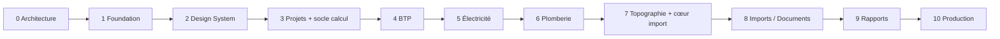

# 07 — Roadmap

Règle : une phase n'est close que lorsque **tous** ses critères de sortie sont atteints
et vérifiés en CI (principe P9). Les phases sont séquentielles. Les ajustements
d'ordre proposés (I3, I4) sont signalés.

---

## Phase 0 — Architecture *(validée le 2026-10-08)*

**Livrables** : les documents 00 à 07, les approfondissements 10 à 13, les ADR 0001 à 0010.

**Critères de sortie**
- [x] Documents relus et validés par le porteur du projet.
- [x] Interprétations I1 à I6 acceptées par défaut au lancement de la Phase 1. Elles restent révisables, et I2 (périmètre BTP) doit être confirmée avant la Phase 4.
- [x] ADR passées au statut « Accepté ».

---

## Phase 1 — Foundation *(terminée le 2026-10-08, en revue)*

**Objectif** : un squelette exécutable, sécurisé et testé, sans aucune fonctionnalité métier.

**Livrables**
- Monorepo (pnpm, Turborepo), configurations TypeScript et ESLint partagées, `dependency-cruiser`.
- `docker/compose.dev.yml` : PostgreSQL 17, Mailpit. *(MinIO est reporté à la Phase 8, premier
  besoin de stockage de fichiers : aucun service inutilisé.)*
- `db` : schéma Prisma initial (identité, organisations, adhésions, invitations, audit),
  migrations, trigger d'immuabilité sur `audit_logs`.
- Authentification (inscription, vérification d'e-mail, connexion, déconnexion,
  réinitialisation du mot de passe, sessions en base).
- `domain/access` : rôles, permissions, matrice RBAC. `application/context` : contexte de requête.
- Isolation des organisations : repositories scopés + **spike RLS** (Prisma + `set_config`),
  conclu par une décision dans l'ADR-0006.
- Journal d'audit (écriture transactionnelle avec la mutation).
- Conventions API : adaptateur Route Handler générique (validation Zod, RFC 9457, `X-Request-Id`).
- Limitation de débit sur les endpoints d'authentification.
- Validation des variables d'environnement au démarrage (Zod).
- `calc-core` : pipeline, registre d'unités, structure de résultat, trace, résolution des
  paramètres, testés avec des moteurs **de test uniquement** (jamais exposés).
- CI GitHub Actions complète ([06 §6](06-strategie-de-tests.md)).

**Critères de sortie**
- [x] Chaîne CI verte : typecheck, lint, règles de couches, unitaires, intégration, build.
  Vérifiée localement avec les commandes exactes du workflow ; le workflow GitHub s'exécutera
  au premier push (aucun dépôt distant à ce jour).
- [x] Tests d'isolation : un utilisateur de l'organisation A ne lit ni ne modifie aucune ressource
  de B (404 via l'API ; 0 ligne visible et écriture refusée au niveau PostgreSQL par la RLS).
- [x] Matrice de permissions testée pour les endpoints existants (générée depuis `domain/access`,
  qui est lui-même comparé au tableau de `12-securite-rbac.md`).
- [x] `calc-core` couvert à ≥ 95 % (lignes 100 %, branches 95,4 %) ; tests de déterminisme
  (sérialisation canonique identique sur deux exécutions, propriété vérifiée par fast-check).
  Le hachage SHA-256 du snapshot sera branché avec les révisions de calcul (Phase 3).
- [x] Toute action sensible écrit une ligne d'audit dans la même transaction (vérifié par les tests).
- [x] `pnpm dev` démarre l'ensemble en suivant le README. Vérifié depuis une copie propre :
  installation depuis le lockfile et typecheck (ce test a révélé et fait corriger une dépendance
  manquante de la génération Prisma dans le pipeline Turborepo). Parcours complet vérifié dans
  l'application lancée : inscription, e-mail réel (Mailpit), vérification, organisation,
  invitation acceptée, changement de rôle, journal d'audit.

**Bilan chiffré** : 112 tests unitaires, 104 tests d'intégration sur PostgreSQL réel,
0 violation de couche, build de production réussi.

**Écarts et décisions prises pendant la phase**
- TypeScript 6.0.3 (et non 7.x) : `typescript-eslint` n'accepte pas encore TypeScript ≥ 6.1.
- Prisma 7.10.0 : l'étiquette npm « latest » pointait vers une version 8 candidate.
- Port PostgreSQL de développement : 5434 (5432 et 5433 déjà utilisés sur le poste).
- Verrouillage optimiste (ETag / If-Match) mis en place dès maintenant sur les membres,
  conformément aux conventions API.
- 2FA (TOTP) : reportée en Phase 3, avant l'ouverture à de vrais utilisateurs.
- Écrans de la Phase 1 volontairement sobres et provisoires : remplacés en Phase 2.

---

## Phase 2 — Design System *(validée le 2026-10-09)*

**Livrables** (détail : [14 — Design system](14-design-system.md))
- `packages/ui` : tokens (couleurs, typographie, rayons, mouvement), thèmes clair et sombre, composants shadcn/ui adaptés.
- Shell : sidebar + header + espace de travail (bureau) ; header + espace de travail + panneau de navigation (mobile).
- Palette Ctrl+K (navigation, organisations, actions), registre de raccourcis clavier avec aide (`?`).
- Composants d'état : squelettes, état vide, état d'erreur, boîte de confirmation, notifications (toasts).
- `DataTable` (tri, filtre, pagination par curseur, saisie tabulaire au clavier).
- **Composants de calcul génériques**, alimentés par le contrat `CalculationView` (`packages/contracts`) : entrées, hypothèses, paramètres (source et statut de vérification), résultats, vérifications, avertissements, trace des formules (KaTeX).
- Storybook avec tous les composants et leurs états.
- Application web reconstruite sur le design system : textes centralisés (next-intl), formulaires React Hook Form + Zod, données serveur via TanStack Query, registre des modules (`domain/modules`) pour la navigation, pages de chargement, d'erreur et 404.

**Critères de sortie**
- [x] Chaque composant a ses stories (49, y compris les états) et des tests de composant (136 tests du package).
- [x] Zéro violation axe : sur chaque story (jsdom) et sur chaque page réelle en navigateur, en clair et en sombre, contraste et repères compris (E2E Playwright).
- [x] Navigation clavier vérifiée : lien d'évitement, Ctrl+K, raccourcis, grille de données, confirmations, panneau mobile.
- [x] Contrastes AA en clair et en sombre (test des tokens : 57 contrôles).
- [x] Shell utilisable de 360 px à 1920 px de large (aucun défilement horizontal à 360, 768, 1280 et 1920 px).

**Bilan chiffré** : 136 tests du design system, 28 tests E2E, chaîne CI complète au vert en local.

**Écarts et décisions**
- Centre de notifications : reporté en Phase 3, avec la table des notifications in-app (sans elle, il serait vide : principe P7). Les toasts sont en place.
- TanStack Table (v9, version majeure récente) non retenu : le `DataTable` est écrit dans le dépôt, pour maîtriser le motif « grid » au clavier.
- Zustand n'est pas encore utilisé : aucun état d'interface global ne le justifie à ce stade.
- Fuseau d'affichage : configurable (`APP_TIME_ZONE`, Africa/Abidjan par défaut) ; préférence par utilisateur en Phase 3.
- Le passage de `CalculationResult` (moteur) à `CalculationView` (API) sera écrit avec les révisions de calcul (Phase 3).

---

## Phase 3 — Projets + socle calcul et référentiels *(validée le 2026-10-11)*

**Livrables**
- Projets : création, modification, archivage, métiers activés, membres, permissions projet, fil d'activité.
- Données de projet : jeux de données typés et versionnés, saisie tabulaire.
- Études, calculs, **révisions immuables**, historique, comparaison de deux révisions.
- Workflow validation → vérification (quatre yeux), rejet motivé, notifications.
- Dépendances entre calculs et signalement d'obsolescence.
- Référentiels : modèle `Standard` / `StandardVersion` / `Parameter` / `Rule`, profils,
  surcharges organisation / projet avec justification, interface de la bibliothèque (consultation).
- Rôle `PlatformAdmin` : publication des référentiels système.
- Double authentification TOTP **facultative** (décision du 2026-10-09), transfert de propriété.
- Moteur de **démonstration** (sans valeur technique) activé uniquement en développement et en test
  (`CONSULPRO_DEMO_ENGINES=true`), pour éprouver le socle de calcul avant le premier moteur métier (Phase 4).
- Centre de notifications in-app ; fuseau horaire par utilisateur ; passage `CalculationResult` → `CalculationView` (présentateur).
- Recherche globale sur les données (projets, études, calculs).
- Onglets Documents et Rapports présents mais désactivés, avec la mention « Disponible en Phase 8 / 9 ».

**Critères de sortie**
- [x] Tests d'intégration sur PostgreSQL : révisions immuables (le rôle applicatif n'a ni UPDATE ni
  DELETE ; un trigger bloque même le propriétaire), un vérificateur ne peut pas être l'auteur (trigger
  `apply_calculation_review`, y compris en écrivant directement en base), un projet archivé est en
  lecture seule (triggers sur toutes ses tables).
- [x] Matrice de permissions générée pour les 64 endpoints : rôle d'organisation × permission ; pour
  les routes de projet, membre du projet ou non, rôle effectif borné par le rôle de projet ; routes de
  la plateforme (administrateur seulement).
- [x] Résolution des paramètres testée (projet > organisation > référentiel), snapshot figé dans la
  révision et empreinte SHA-256 du JSON canonique, recalculée et comparée dans les tests.
- [x] E2E : créer un projet → inviter un membre → créer une étude → calculer (moteur de démonstration)
  → valider → vérifier par un autre utilisateur, notifié dans l'application.

**Bilan chiffré** : 340 tests unitaires et de calcul, 668 tests d'intégration (dont 627 côté API),
68 tests E2E (accessibilité axe de chaque page en clair et en sombre, de 360 à 1920 px).

**Écarts et décisions**
- Profils de référentiels : la sélection, par métier, des versions retenues par chaque projet (les
  dernières versions publiées du métier par défaut), visible et modifiable dans l'onglet Référentiels.
- Référentiels propres à une organisation (`CUSTOM`) : non livrés (consultation et surcharges
  seulement, comme prévu) ; le modèle et la RLS les permettent déjà.
- Les surcharges de tables passent par l'API ; l'interface propose les scalaires et les énumérés.
- Une exécution aux entrées refusées (`INVALID`) n'est pas enregistrée : l'erreur est renvoyée champ
  par champ et l'utilisateur corrige sa saisie. Les autres statuts (dont `ERROR`) créent une révision.
- La présentation du moteur (libellés, précisions) est figée dans chaque révision : son affichage ne
  dépend plus du moteur, même retiré du serveur.
- Recherche globale : sous-chaîne insensible aux accents (`unaccent`) sur les intitulés de projets,
  études et calculs ; les jeux de données ne sont pas indexés.
- Moteurs de démonstration : refusés au démarrage quand l'environnement est la production
  (`APP_ENV`, sinon `NODE_ENV`) ; le build de production des tests E2E déclare `APP_ENV=test`.
- Le statut HTTP d'une page de projet inexistante est 200 (page diffusée en flux) ; le contenu
  « Page introuvable » et la balise `noindex` le signalent, sans distinguer inexistant et inaccessible.

---

## Phase 4 — BTP *(validée le 2026-10-13)*

**Livrables** : moteurs `btp.*` ([03 §3.1](03-modules.md)), avant-métré, quantitatifs,
décomposition en matériaux, bibliothèque de prix unitaires facultatifs, référentiel
« Usages courants — métré » (valeurs `TO_VERIFY` modifiables), tableau de bord BTP.

- 13 moteurs de quantités (terrassement, semelles, longrines, poteaux, poutres, dalles, escaliers,
  maçonnerie, blocs, cloisons, enduits, carrelage, peinture) ; aciers par ratio ou par nomenclature
  saisie ; saisie de listes (ouvertures, barres) et d'entiers dans le formulaire de calcul.
- Avant-métré : arborescence lot → niveau → ouvrage par projet, rattachement des calculs BTP.
- Quantitatifs (DQE) : lignes reprises des sorties d'ouvrage des calculs rattachés, liées à leur
  révision ; mise à jour depuis l'avant-métré (prix et quantités retenues conservés) ; lignes
  saisies ; quantité retenue justifiée et journalisée ; sous-totaux par nœud ; décomposition en
  matériaux des révisions reprises.
- Bibliothèques de prix de l'organisation (devise, validité, articles liés à un ouvrage) ;
  application à un quantitatif de même devise.
- Tableau de bord BTP de l'organisation ; module BTP actif dans la navigation.

**Critères de sortie**
- [x] Chaque moteur : seuils de [06 §3.2](06-strategie-de-tests.md) atteints — 3 cas nominaux,
  2 limites, 2 refus par moteur ; couverture de `calc-btp` 100 % des lignes, 98 % des branches.
  Reste la contre-vérification des cas par un ingénieur (`checkedBy`, Q6) : les moteurs sont
  affichés « non contre-vérifiés » dans les résultats, les quantitatifs et le tableau de bord.
- [x] Traçabilité de bout en bout : ligne de quantitatif → révision (lien vers la révision exacte,
  statut de contrôle, révision remplacée signalée) → entrées et paramètres figés.
- [x] Quantitatif exploitable sans aucun prix ; totaux corrects avec des prix (décimales exactes
  `NUMERIC(18,4)` transportées en chaînes, arrondi bancaire à l'unité monétaire de la devise).
- [x] Q2 (dimensionnement structurel) tranchée le 2026-10-11 : quantités seulement.

**Écarts et décisions**
- `btp.foundations` n'est pas un moteur : un agrégat recalculé ferait compter deux fois semelles,
  longrines et béton de propreté dans le DQE. L'agrégat « Fondations » est le sous-total du lot
  correspondant de l'avant-métré.
- La structure du quantitatif (lots, chapitres) est celle de l'avant-métré : pas de table
  `BoqSection` distincte ; plusieurs quantitatifs d'un projet partagent la même structure.
- Une ligne calculée est identifiée par (calcul, sortie) ; sa quantité suit le calcul et ne se
  modifie que par une quantité retenue justifiée. Elle se retire en détachant le calcul.
- Montant d'une ligne = quantité retenue × prix unitaire, arrondi au pair à l'unité monétaire ;
  sous-totaux et total = somme des montants de ligne (le DQE se recompte à la main).
- Matériaux : seuls les matériaux génériques (ciment, sable, gravier, eau, aciers, blocs, colle,
  joint) se cumulent entre calculs (`additive`) ; les autres (formats de carreaux, entrevous,
  peintures, plaques…) restent présentés calcul par calcul.
- Un article de prix par ouvrage et par bibliothèque ; aucune conversion de devise ; la
  suppression d'une bibliothèque laisse les prix déjà reportés sur les lignes, sans lien.
- Statut de quantitatif (brouillon / figé) non livré : le contrôle reste celui des révisions de
  calcul ; à réévaluer avec les rapports (Phase 9).

**Bilan chiffré** : 135 tests des moteurs BTP, 77 tests du domaine, 69 tests applicatifs ;
949 tests d’intégration sur PostgreSQL (dont 902 côté API, 881 pour la matrice de permissions
étendue aux 25 nouvelles routes) ; 82 tests E2E (parcours de métré, bibliothèque de prix,
accessibilité des six nouvelles pages en clair et en sombre, de 360 à 1920 px).

---

## Phase 5 — Électricité *(validée le 2026-10-13)*

**Livrables** : moteurs `elec.*`, arborescence tableaux / départs / équipements,
référentiel NF C 15-100 + guide UTE C 15-105 (édition 2002 et amendements, Q4 tranchée le
2026-10-13), tableau de bord. Q3 tranchée le 2026-10-13 : la Guinée (GNF) en priorité.

- 6 moteurs : bilan de puissance (`elec.power-balance`), courant d'emploi, circuit complet
  (I_B → I_n → section → chute de tension, section augmentée tant que la chute cumulée dépasse la
  limite), section des câbles, chute de tension (cumul amont), protection (I_B ≤ I_n,
  I2 ≤ 1,45 I_z, pouvoir de coupure si I_cc fourni, différentiel ≤ 30 mA sur les prises).
- Jeu de données `ELEC_BOARD_TREE` (TGBT → tableaux → départs ; colonnes à choix et nombres)
  contrôlé à l'enregistrement (repères uniques, une seule origine, amont tableau, boucles).
- Entrée « jeu de données » d'un moteur : le serveur lit la révision courante du jeu choisi et
  la trace (`calculation_dataset_links`, ajout seul) ; une nouvelle révision du jeu rend le
  calcul obsolète, comme une dépendance entre calculs.
- Référentiels `NFC15-100` (2002) et `UTE-C15-105` (2003) : courants admissibles (cuivre,
  méthodes B, C, E), facteurs de température et de groupement, limites de chute de tension,
  rapport I2 / I_z, k2 par dispositif et calibre, ks de distribution, ρ et λ. Toutes les valeurs
  sont saisies par ConsulPro en citant leur tableau et restent « à vérifier » (Q4).
- Tableau de bord Électricité de l'organisation ; module actif dans la navigation.
- Paramètres de l'organisation (Q3) : nom, pays, devise proposée aux nouveaux quantitatifs et
  bibliothèques de prix (Guinée → GNF préremplie), sous If-Match, audités.

**Critères de sortie**
- [x] Seuils de tests atteints : 7 cas de référence par moteur (3 nominaux, 2 limites,
  2 refus) ; couverture de `calc-elec` 100 % des lignes, 97 % des branches ; propriétés
  (fast-check) : proportionnalités, monotonies de la chute et de la section, I_B ≤ I_n et
  I2 ≤ 1,45 I_z dès qu'un calibre est retenu, P absorbée ≤ P installée.
- [x] Mutation ≥ 80 % : 99,9 % sur `circuits.ts` (`elec.cable-sizing`, `elec.voltage-drop`,
  `elec.protection`, `elec.circuit`) et `formulas.ts` (Stryker, `pnpm --filter
  @consulpro/calc-elec test:mutation`). Les mutants équivalents sont annotés dans le code.
- [x] Q3 et Q4 tranchées le 2026-10-13.
- Reste la contre-vérification des cas par un ingénieur électricien (`checkedBy`, Q6) et le
  contrôle des valeurs normatives sur un exemplaire des textes : moteurs affichés « non
  contre-vérifiés », paramètres « à vérifier » dans chaque résultat et dans la bibliothèque.

**Écarts et décisions**
- Courants admissibles : âme cuivre, méthodes de référence B, C et E seulement (ni aluminium
  pour I_z, ni méthodes D et F) ; la chute de tension accepte cuivre et aluminium.
- Pas de courbes de déclenchement B / C / D : la protection contre les surcharges est vérifiée
  par I2 = k2 · I_n ; les courts-circuits (I_cc, contraintes thermiques) ne sont pas calculés,
  I_cc est une entrée facultative fournie par le distributeur ou une étude.
- Le bilan de puissance lit l'arbre complet d'un jeu ; ks par tableau saisi ou, à défaut, lu
  dans le référentiel selon le nombre de départs (hypothèse visible).
- Un calcul ne lit qu'une révision de jeu de données par entrée ; aucune ligne n'est saisie
  dans le formulaire de calcul (refus `INPUT_DATASET_INVALID`).
- Le pays de l'organisation ne choisit aucun référentiel : la NF C 15-100 reste la référence
  en Guinée tant qu'aucune norme nationale dérivée n'est retenue.
- Stryker s'exécute avec le lanceur `command` (Vitest 5 n'active pas les mutants avec le
  lanceur Vitest de Stryker 10 : résultats faussement « survivants »).

---

## Phase 6 — Plomberie & Sanitaire *(validée le 2026-10-14)*

**Livrables** : moteurs `plumbing.*`, inventaire des appareils, référentiels
DTU 60.11 / DTU 64.1 et usages, quantitatifs plomberie, tableau de bord. Q7, Q8 et Q9 tranchées
le 2026-10-13 : NF DTU 2013 ; PVC, PPR, PEHD, cuivre, acier galvanisé ; linéaires par diamètre au
DQE, présentation agrégée au choix.

- 11 moteurs : débits (simultanéité du DTU 60.11), réseau d'alimentation arborescent (débits,
  diamètres, vitesses, pertes de charge, pression à chaque point de puisage), diamètre, pertes de
  charge (Darcy-Weisbach, Colebrook-White itératif), pression au point de puisage, évacuation
  (NF EN 12056-2 système I, Manning-Strickler, chutes), fosse toutes eaux et puisard, regards,
  réservoir, pompe ou surpresseur, chauffe-eau à accumulation.
- Jeux de données `SANITARY_FIXTURES` (inventaire par niveau et local) et `PLUMBING_NETWORK`
  (tronçons, contrôle de l'arborescence).
- Référentiels `NF-DTU-60.11` (2013), `NF-DTU-64.1` (2013), `TUBES-EN` (dimensions et rugosités) et
  `PLUMBING-USAGES` : toutes les valeurs sont saisies par ConsulPro et restent « à vérifier ».
- Sorties ventilées (ADR-0011) : linéaires de tubes par matériau et diamètre, appareils par type,
  chauffe-eau par capacité ; une ligne de DQE par entrée, présentation agrégée par groupe au choix
  (paramètre du quantitatif) ; prix par diamètre dans les bibliothèques.
- Avant-métré et quantitatifs ouverts aux projets de plomberie ; tableau de bord Plomberie ; module
  actif dans la navigation.

**Critères de sortie**
- [x] Seuils de tests atteints : 7 cas de référence par moteur au moins (8 pour le chauffe-eau),
  calculés indépendamment (Colebrook-White par Newton) ; couverture de `calc-plumbing` 99,8 % des
  lignes, 98,7 % des branches ; propriétés : pertes de charge croissantes avec le débit et la
  longueur, décroissantes avec le diamètre ; vitesse ≤ vitesse maximale ; débit admissible ≥ débit
  d'eaux usées.
- [x] Convergence de Colebrook-White testée : résidu de l'équation implicite < 10⁻⁹ de Re = 4 000
  à 10⁸, valeur de contrôle du diagramme de Moody, régime laminaire, non-convergence ⇒ échec
  explicite (aucune valeur).
- [x] Mutation (moteurs de pression, 06 §3) : 93,9 % sur `hydraulics.ts` et `supply.ts`.
- Reste la contre-vérification des cas par un ingénieur plombier (`checkedBy`, Q6) et le contrôle
  des valeurs sur un exemplaire des textes : moteurs affichés « non contre-vérifiés ».

**Écarts et décisions**
- Simultanéité y = a / √(x − 1) pour tous les usages ; les usages intensifs (douches collectives)
  restent à traiter par le bureau d'études (hypothèse affichée).
- Évacuation : méthode de la NF EN 12056-2 (système I) reprise par le DTU 60.11 partie 2 ; tubes
  PVC d'évacuation seulement ; chutes à ventilation primaire.
- Fosse : volume du NF DTU 64.1 (pièces principales) ou méthode par usager (pratique courante) ;
  le puisard se dimensionne seulement d'après une perméabilité mesurée sur site.
- Eaux pluviales (DTU 60.11 partie 3) non traitées.
- Une variante de prix (diamètre) n'est proposée qu'après son apparition dans un quantitatif.

---

## Phase 7 — Topographie + cœur du pipeline d'import *(ajustement I3)*

**Livrables** : moteurs `topo.*`, jeux de points et d'observations, conventions
d'angles paramétrables, tolérances paramétrables ; **package `importers`** (XLSX, CSV,
copier-coller Excel et Word ; détection, mapping, validation, aperçu, import) appliqué
aux jeux de points et d'observations.

**Critères de sortie**
- [ ] Propriétés : fermeture nulle après Bowditch, cohérence du nivellement compensé.
- [ ] Corpus de fixtures d'import ([06 §5](06-strategie-de-tests.md)) entièrement passant.
- [ ] Mesure des performances sur un levé de 50 000 points (décision sur le stockage `jsonb`).

---

## Phase 8 — Imports généralisés / Documents

**Livrables** : imports pour les jeux de données des autres métiers, modèles de mapping
réutilisables ; documents (upload sécurisé par URL signée, quarantaine, détection du
type réel, versions, catégories, téléchargement par URL signée de courte durée).

**Critères de sortie**
- [ ] Fichiers hostiles rejetés (fixtures) ; aucun fichier servi en ligne avec un type exécutable.
- [ ] Permissions documents testées ; suppression logique et purge auditées.

---

## Phase 9 — Rapports

**Livrables** : Report Builder (structure : couverture, projet, auteur, objet, données,
hypothèses, méthodologie, calculs, résultats, contrôles, observations, conclusion),
modèles d'organisation, rendus PDF / DOCX / XLSX, génération asynchrone, rendus
immuables. Spike PDF tranché au début de la phase.

**Critères de sortie**
- [ ] Un rapport régénéré à partir des mêmes révisions produit un contenu identique.
- [ ] Une révision non vérifiée apparaît avec une mention explicite « Non vérifié ».
- [ ] Contenu des DOCX et XLSX relu par les tests ; texte du PDF extrait et contrôlé.
- [ ] Aucune injection de formule dans les exports XLSX / CSV.

---

## Phase 10 — Production

**Livrables** : durcissement (en-têtes de sécurité et CSP, revue de sécurité, analyse
antivirus des fichiers), sauvegardes (PITR, restauration testée), supervision (journaux,
métriques, alertes), tests de charge, procédure de déploiement et de retour arrière,
documentation utilisateur, décision d'hébergement (Q5).

**Critères de sortie**
- [ ] Restauration complète testée et chronométrée (RPO et RTO mesurés).
- [ ] Revue de sécurité sans constat critique ou majeur ouvert.
- [ ] Runbooks : incident, restauration, rotation des secrets.
