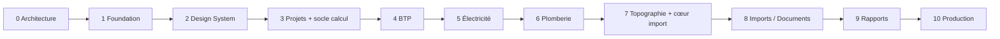

# 07 — Roadmap

Règle : une phase n'est close que lorsque **tous** ses critères de sortie sont atteints
et vérifiés en CI (principe P9). Les phases sont séquentielles. Les ajustements
d'ordre proposés (I3, I4) sont signalés.

---

## Phase 0 — Architecture *(validée le 2026-10-08)*

**Livrables** : les documents 00 à 07, les approfondissements 10 à 13, les ADR 0001 à 0010.

**Critères de sortie**
- [x] Documents relus et validés par le porteur du projet.
- [x] Interprétations I1 à I6 acceptées par défaut au lancement de la Phase 1. Elles restent révisables, et I2 (périmètre BTP) doit être confirmée avant la Phase 4.
- [x] ADR passées au statut « Accepté ».

---

## Phase 1 — Foundation *(terminée le 2026-10-08, en revue)*

**Objectif** : un squelette exécutable, sécurisé et testé, sans aucune fonctionnalité métier.

**Livrables**
- Monorepo (pnpm, Turborepo), configurations TypeScript et ESLint partagées, `dependency-cruiser`.
- `docker/compose.dev.yml` : PostgreSQL 17, Mailpit. *(MinIO est reporté à la Phase 8, premier
  besoin de stockage de fichiers : aucun service inutilisé.)*
- `db` : schéma Prisma initial (identité, organisations, adhésions, invitations, audit),
  migrations, trigger d'immuabilité sur `audit_logs`.
- Authentification (inscription, vérification d'e-mail, connexion, déconnexion,
  réinitialisation du mot de passe, sessions en base).
- `domain/access` : rôles, permissions, matrice RBAC. `application/context` : contexte de requête.
- Isolation des organisations : repositories scopés + **spike RLS** (Prisma + `set_config`),
  conclu par une décision dans l'ADR-0006.
- Journal d'audit (écriture transactionnelle avec la mutation).
- Conventions API : adaptateur Route Handler générique (validation Zod, RFC 9457, `X-Request-Id`).
- Limitation de débit sur les endpoints d'authentification.
- Validation des variables d'environnement au démarrage (Zod).
- `calc-core` : pipeline, registre d'unités, structure de résultat, trace, résolution des
  paramètres, testés avec des moteurs **de test uniquement** (jamais exposés).
- CI GitHub Actions complète ([06 §6](06-strategie-de-tests.md)).

**Critères de sortie**
- [x] Chaîne CI verte : typecheck, lint, règles de couches, unitaires, intégration, build.
  Vérifiée localement avec les commandes exactes du workflow ; le workflow GitHub s'exécutera
  au premier push (aucun dépôt distant à ce jour).
- [x] Tests d'isolation : un utilisateur de l'organisation A ne lit ni ne modifie aucune ressource
  de B (404 via l'API ; 0 ligne visible et écriture refusée au niveau PostgreSQL par la RLS).
- [x] Matrice de permissions testée pour les endpoints existants (générée depuis `domain/access`,
  qui est lui-même comparé au tableau de `12-securite-rbac.md`).
- [x] `calc-core` couvert à ≥ 95 % (lignes 100 %, branches 95,4 %) ; tests de déterminisme
  (sérialisation canonique identique sur deux exécutions, propriété vérifiée par fast-check).
  Le hachage SHA-256 du snapshot sera branché avec les révisions de calcul (Phase 3).
- [x] Toute action sensible écrit une ligne d'audit dans la même transaction (vérifié par les tests).
- [x] `pnpm dev` démarre l'ensemble en suivant le README. Vérifié depuis une copie propre :
  installation depuis le lockfile et typecheck (ce test a révélé et fait corriger une dépendance
  manquante de la génération Prisma dans le pipeline Turborepo). Parcours complet vérifié dans
  l'application lancée : inscription, e-mail réel (Mailpit), vérification, organisation,
  invitation acceptée, changement de rôle, journal d'audit.

**Bilan chiffré** : 112 tests unitaires, 104 tests d'intégration sur PostgreSQL réel,
0 violation de couche, build de production réussi.

**Écarts et décisions prises pendant la phase**
- TypeScript 6.0.3 (et non 7.x) : `typescript-eslint` n'accepte pas encore TypeScript ≥ 6.1.
- Prisma 7.10.0 : l'étiquette npm « latest » pointait vers une version 8 candidate.
- Port PostgreSQL de développement : 5434 (5432 et 5433 déjà utilisés sur le poste).
- Verrouillage optimiste (ETag / If-Match) mis en place dès maintenant sur les membres,
  conformément aux conventions API.
- 2FA (TOTP) : reportée en Phase 3, avant l'ouverture à de vrais utilisateurs.
- Écrans de la Phase 1 volontairement sobres et provisoires : remplacés en Phase 2.

---

## Phase 2 — Design System *(terminée le 2026-10-09, en revue)*

**Livrables** (détail : [14 — Design system](14-design-system.md))
- `packages/ui` : tokens (couleurs, typographie, rayons, mouvement), thèmes clair et sombre, composants shadcn/ui adaptés.
- Shell : sidebar + header + espace de travail (bureau) ; header + espace de travail + panneau de navigation (mobile).
- Palette Ctrl+K (navigation, organisations, actions), registre de raccourcis clavier avec aide (`?`).
- Composants d'état : squelettes, état vide, état d'erreur, boîte de confirmation, notifications (toasts).
- `DataTable` (tri, filtre, pagination par curseur, saisie tabulaire au clavier).
- **Composants de calcul génériques**, alimentés par le contrat `CalculationView` (`packages/contracts`) : entrées, hypothèses, paramètres (source et statut de vérification), résultats, vérifications, avertissements, trace des formules (KaTeX).
- Storybook avec tous les composants et leurs états.
- Application web reconstruite sur le design system : textes centralisés (next-intl), formulaires React Hook Form + Zod, données serveur via TanStack Query, registre des modules (`domain/modules`) pour la navigation, pages de chargement, d'erreur et 404.

**Critères de sortie**
- [x] Chaque composant a ses stories (49, y compris les états) et des tests de composant (136 tests du package).
- [x] Zéro violation axe : sur chaque story (jsdom) et sur chaque page réelle en navigateur, en clair et en sombre, contraste et repères compris (E2E Playwright).
- [x] Navigation clavier vérifiée : lien d'évitement, Ctrl+K, raccourcis, grille de données, confirmations, panneau mobile.
- [x] Contrastes AA en clair et en sombre (test des tokens : 57 contrôles).
- [x] Shell utilisable de 360 px à 1920 px de large (aucun défilement horizontal à 360, 768, 1280 et 1920 px).

**Bilan chiffré** : 136 tests du design system, 28 tests E2E, chaîne CI complète au vert en local.

**Écarts et décisions**
- Centre de notifications : reporté en Phase 3, avec la table des notifications in-app (sans elle, il serait vide : principe P7). Les toasts sont en place.
- TanStack Table (v9, version majeure récente) non retenu : le `DataTable` est écrit dans le dépôt, pour maîtriser le motif « grid » au clavier.
- Zustand n'est pas encore utilisé : aucun état d'interface global ne le justifie à ce stade.
- Fuseau d'affichage : configurable (`APP_TIME_ZONE`, Africa/Abidjan par défaut) ; préférence par utilisateur en Phase 3.
- Le passage de `CalculationResult` (moteur) à `CalculationView` (API) sera écrit avec les révisions de calcul (Phase 3).

---

## Phase 3 — Projets + socle calcul et référentiels *(ajustement I4)*

**Livrables**
- Projets : création, modification, archivage, métiers activés, membres, permissions projet, fil d'activité.
- Données de projet : jeux de données typés et versionnés, saisie tabulaire.
- Études, calculs, **révisions immuables**, historique, comparaison de deux révisions.
- Workflow validation → vérification (quatre yeux), rejet motivé, notifications.
- Dépendances entre calculs et signalement d'obsolescence.
- Référentiels : modèle `Standard` / `StandardVersion` / `Parameter` / `Rule`, profils,
  surcharges organisation / projet avec justification, interface de la bibliothèque (consultation).
- Rôle `PlatformAdmin` : publication des référentiels système.
- Double authentification TOTP (obligatoire pour Owner et Admin), transfert de propriété.
- Centre de notifications in-app ; fuseau horaire par utilisateur ; passage `CalculationResult` → `CalculationView` (présentateur).
- Recherche globale sur les données (projets, études, calculs).
- Onglets Documents et Rapports présents mais désactivés, avec la mention « Disponible en Phase 8 / 9 ».

**Critères de sortie**
- [ ] Tests d'intégration : immuabilité des révisions (trigger), un vérificateur ne peut pas être l'auteur, un projet archivé est en lecture seule.
- [ ] Matrice de permissions complète pour tous les endpoints Projets / Études / Calculs / Bibliothèque.
- [ ] Résolution des paramètres testée (priorité projet > organisation > référentiel, snapshot et hash).
- [ ] E2E : créer un projet → inviter un membre → créer une étude → (moteur de test) calculer → valider → vérifier par un autre utilisateur.

---

## Phase 4 — BTP

**Livrables** : moteurs `btp.*` ([03 §3.1](03-modules.md)), avant-métré, quantitatifs,
décomposition en matériaux, bibliothèque de prix unitaires facultatifs, référentiel
« Usages courants — métré » (valeurs `TO_VERIFY` modifiables), tableau de bord BTP.

**Critères de sortie**
- [ ] Chaque moteur : seuils de [06 §3.2](06-strategie-de-tests.md) atteints.
- [ ] Traçabilité de bout en bout : ligne de quantitatif → révision → entrées et paramètres.
- [ ] Quantitatif exploitable sans aucun prix ; totaux corrects avec des prix (`Decimal`, devise).
- [ ] Q2 (dimensionnement structurel) tranchée.

---

## Phase 5 — Électricité

**Livrables** : moteurs `elec.*`, arborescence tableaux / départs / équipements,
référentiel NF C 15-100 + guide UTE C 15-105 (version tranchée par Q4), tableau de bord.

**Critères de sortie**
- [ ] Seuils de tests atteints ; propriétés (monotonies, conditions I_B ≤ I_n ≤ I_z) vérifiées.
- [ ] Mutation ≥ 80 % sur `elec.voltage-drop`, `elec.cable-sizing`, `elec.protection`.
- [ ] Cas de référence contre-vérifiés par un ingénieur électricien (Q6).

---

## Phase 6 — Plomberie & Sanitaire

**Livrables** : moteurs `plumbing.*`, inventaire des appareils, référentiels
DTU 60.11 / DTU 64.1 et usages, quantitatifs plomberie, tableau de bord.

**Critères de sortie**
- [ ] Seuils de tests atteints ; convergence de Colebrook-White testée (cas limites, non-convergence ⇒ `ERROR`).
- [ ] Cas de référence contre-vérifiés (Q6).

---

## Phase 7 — Topographie + cœur du pipeline d'import *(ajustement I3)*

**Livrables** : moteurs `topo.*`, jeux de points et d'observations, conventions
d'angles paramétrables, tolérances paramétrables ; **package `importers`** (XLSX, CSV,
copier-coller Excel et Word ; détection, mapping, validation, aperçu, import) appliqué
aux jeux de points et d'observations.

**Critères de sortie**
- [ ] Propriétés : fermeture nulle après Bowditch, cohérence du nivellement compensé.
- [ ] Corpus de fixtures d'import ([06 §5](06-strategie-de-tests.md)) entièrement passant.
- [ ] Mesure des performances sur un levé de 50 000 points (décision sur le stockage `jsonb`).

---

## Phase 8 — Imports généralisés / Documents

**Livrables** : imports pour les jeux de données des autres métiers, modèles de mapping
réutilisables ; documents (upload sécurisé par URL signée, quarantaine, détection du
type réel, versions, catégories, téléchargement par URL signée de courte durée).

**Critères de sortie**
- [ ] Fichiers hostiles rejetés (fixtures) ; aucun fichier servi en ligne avec un type exécutable.
- [ ] Permissions documents testées ; suppression logique et purge auditées.

---

## Phase 9 — Rapports

**Livrables** : Report Builder (structure : couverture, projet, auteur, objet, données,
hypothèses, méthodologie, calculs, résultats, contrôles, observations, conclusion),
modèles d'organisation, rendus PDF / DOCX / XLSX, génération asynchrone, rendus
immuables. Spike PDF tranché au début de la phase.

**Critères de sortie**
- [ ] Un rapport régénéré à partir des mêmes révisions produit un contenu identique.
- [ ] Une révision non vérifiée apparaît avec une mention explicite « Non vérifié ».
- [ ] Contenu des DOCX et XLSX relu par les tests ; texte du PDF extrait et contrôlé.
- [ ] Aucune injection de formule dans les exports XLSX / CSV.

---

## Phase 10 — Production

**Livrables** : durcissement (en-têtes de sécurité et CSP, revue de sécurité, analyse
antivirus des fichiers), sauvegardes (PITR, restauration testée), supervision (journaux,
métriques, alertes), tests de charge, procédure de déploiement et de retour arrière,
documentation utilisateur, décision d'hébergement (Q5).

**Critères de sortie**
- [ ] Restauration complète testée et chronométrée (RPO et RTO mesurés).
- [ ] Revue de sécurité sans constat critique ou majeur ouvert.
- [ ] Runbooks : incident, restauration, rotation des secrets.
